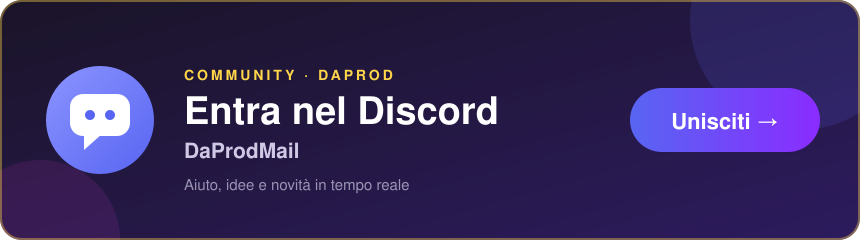

# DaProdMail - Soluzione Email per Clienti con AI

[](https://discord.gg/Njs52aacwq)

DaProdMail è un'applicazione web costruita con Next.js che ti permette di gestire i tuoi clienti, organizzarli in categorie e inviare email personalizzate, con l'aggiunta di funzionalità AI per migliorare i tuoi testi di marketing, utilizzando le informazioni specifiche della tua azienda.

## Funzionalità Principali

*   **Gestione Clienti:**
    *   Aggiungi, modifica ed elimina clienti.
    *   Importa ed esporta la lista clienti tramite file `.txt` (formato: `Nome,email,idCategoria1;idCategoria2;...`).
    *   Assegna clienti a una o più categorie, anche direttamente dalla lista clienti.
    *   Crea categorie al volo durante l'aggiunta/modifica di un cliente.
    *   Elimina tutti i clienti con conferma.
*   **Gestione Categorie:**
    *   Crea, modifica ed elimina categorie per raggruppare i clienti.
*   **Composizione Email Potenziata da AI:**
    *   Scrivi email e inviale a singoli clienti o a intere categorie.
    *   Il corpo dell'email viene inviato come HTML, permettendo formattazione personalizzata.
    *   Utilizza l'intelligenza artificiale (tramite Genkit e Google AI) per:
        *   **Migliorare il corpo dell'email:** Espandi poche parole chiave in un testo di marketing HTML completo, ben strutturato (con titoli e paragrafi), coinvolgente, con un tono formale ma amichevole e un uso limitato di emoji. L'AI non suggerirà immagini.
        *   **Migliorare l'oggetto dell'email:** Genera o raffina oggetti per massimizzare l'impatto e il tasso di apertura, basandosi sul corpo dell'email.
    *   Ricerca clienti per nome/email e opzione "Seleziona Tutti/Deseleziona Tutti (Visibili)" quando si scelgono destinatari individuali.
*   **Informazioni Azienda per AI:**
    *   Pagina dedicata per inserire dettagli sulla tua azienda (nome, sito web, descrizione generale).
    *   Queste informazioni vengono utilizzate dall'AI per generare testi più mirati e pertinenti.
    *   Importa ed esporta queste informazioni tramite file `infoaiazienda.txt`.
*   **Configurazione Semplice:**
    *   Imposta il tuo indirizzo Gmail e una "Password per app" per l'invio effettivo delle email.
    *   Configura la tua chiave API di Google AI per abilitare le funzionalità di miglioramento del testo.
    *   Importa ed esporta le credenziali (email, password per app, chiave API) tramite file `credenzialidaprodmail.txt` (con avviso sulla sicurezza).
*   **Interfaccia Utente Moderna:**
    *   Realizzata con ShadCN UI e Tailwind CSS per un'esperienza utente pulita e reattiva.
    *   Navigazione intuitiva con sidebar.

## Stack Tecnologico

*   **Framework Frontend:** [Next.js](https://nextjs.org/) (con App Router)
*   **Libreria UI:** [React](https://react.dev/)
*   **Linguaggio:** [TypeScript](https://www.typescriptlang.org/)
*   **Componenti UI:** [ShadCN UI](https://ui.shadcn.com/)
*   **Styling:** [Tailwind CSS](https://tailwindcss.com/)
*   **Funzionalità AI:** [Genkit](https://firebase.google.com/docs/genkit) (con il provider Google AI)
*   **Invio Email:** [Nodemailer](https://nodemailer.com/) (configurato per Gmail con Password per app)
*   **Validazione Schemi:** [Zod](https://zod.dev/)
*   **Icone:** [Lucide React](https://lucide.dev/)
*   **Gestione Stato Locale:** React Context API con `localStorage` per la persistenza.

## Per Iniziare

1.  **Clona il repository (se applicabile) o apri il progetto in Firebase Studio.**
2.  **Installa le dipendenze:**
    ```bash
    npm install
    # o
    yarn install
    # o
    pnpm install
    ```
3.  **Configura le impostazioni dell'applicazione:**
    *   Naviga alla pagina "Impostazioni" nell'applicazione.
        *   Inserisci il tuo indirizzo **Email Google Mail** e la relativa **Password per App**. Puoi generare una Password per App [qui](https://myaccount.google.com/apppasswords).
        *   Inserisci la tua **Chiave API Google AI**. Puoi ottenerla da [Google AI Studio](https://aistudio.google.com/app/apikey).
        *   *Nota: Le funzionalità AI richiederanno una chiave API Google AI valida. L'invio email richiederà un indirizzo Gmail e una Password per App validi.*
    *   Naviga alla pagina "Info AI Azienda".
        *   Inserisci le informazioni sulla tua azienda (nome, sito web, dettagli) per personalizzare i testi generati dall'AI.
4.  **Avvia l'applicazione in modalità sviluppo:**
    ```bash
    npm run dev
    ```
    L'applicazione sarà disponibile su `http://localhost:9002` (o la porta specificata).
5.  **Avvia Genkit per le funzionalità AI (in un terminale separato):**
    ```bash
    npm run genkit:dev
    ```
    *Assicurati di aver impostato la variabile d'ambiente `GOOGLE_API_KEY` se il tuo provider Google AI in Genkit la richiede a livello di ambiente, oppure assicurati che la chiave API inserita nelle impostazioni dell'app sia usata correttamente dai flussi Genkit.*

## Script Disponibili

Nel `package.json`, troverai i seguenti script:

*   `npm run dev`: Avvia l'applicazione Next.js in modalità sviluppo con Turbopack.
*   `npm run genkit:dev`: Avvia il server Genkit in modalità sviluppo per le funzionalità AI.
*   `npm run genkit:watch`: Avvia il server Genkit in modalità sviluppo con hot-reloading per i file AI.
*   `npm run build`: Compila l'applicazione Next.js per la produzione.
*   `npm run start`: Avvia un server di produzione Next.js.
*   `npm run lint`: Esegue ESLint per l'analisi statica del codice.
*   `npm run typecheck`: Esegue il controllo dei tipi TypeScript.

## Struttura del Progetto (Sommario)

*   `src/app/`: Contiene le pagine dell'applicazione (routing basato su App Router).
*   `src/components/`: Contiene i componenti React riutilizzabili, inclusi i componenti UI di ShadCN.
*   `src/ai/`: Contiene la logica relativa all'intelligenza artificiale (flussi Genkit).
*   `src/contexts/`: Contiene i provider di contesto React (es. `AppStateContext`).
*   `src/hooks/`: Contiene custom hooks React.
*   `src/lib/`: Contiene utility e funzioni di supporto.
*   `src/types/`: Contiene le definizioni dei tipi TypeScript.

Sperimenta con DaProdMail e rendi le tue campagne email più efficaci!

---

<!-- discord-card -->
## 💬 Community

<p align="center">
  <a href="https://discord.gg/Njs52aacwq"></a>
</p>

Domande, idee, bug o solo voglia di chiacchierare? Entra nel **[Discord di DaProd](https://discord.gg/Njs52aacwq)**: ogni app ha la sua stanza e le nuove versioni arrivano in automatico.
